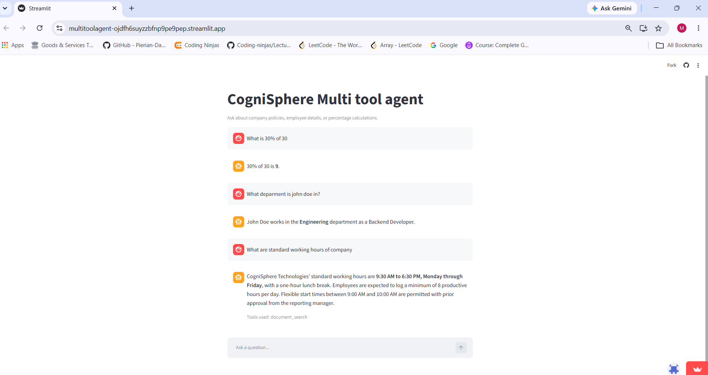

# CogniSphere Multi-Tool Agent

CogniSphere is a tool-using LLM agent that chooses tools, executes them, and turns the results into a natural-language response. It supports policy-handbook questions, employee lookups, department headcounts, and percentage calculations, including multi-step questions.

**Live demo:** https://multitoolagent-ojdfh6suyzzbfnp9pe9pep.streamlit.app/  
**API:** https://multi-tool-agent-wj9b.onrender.com  
**Interactive API docs:** https://multi-tool-agent-wj9b.onrender.com/docs  
**Health check:** https://multi-tool-agent-wj9b.onrender.com/health

> The backend uses free hosting and may sleep while idle. The first request after inactivity can take longer to respond.

## Application Screenshot



## Features

- **Tool routing:** the agent selects an appropriate tool for supported questions.
- **Document Q&A (RAG):** searches a fictional employee policy handbook PDF using FAISS and FastEmbed embeddings.
- **Employee lookup:** retrieves information from sample employee records.
- **Department headcount:** counts sample employees by department.
- **Percentage calculations:** calculates X% of Y and supports “what percentage is X of Y?” questions.
- **Multi-step tool use:** can combine tools for questions requiring more than one operation.
- **Session memory:** conversation state is associated with a session/thread ID.
- **Scope control:** the agent is instructed to decline unsupported questions instead of guessing.
- **REST API and UI:** FastAPI backend with a Streamlit frontend.
- **Testing:** pytest suite and an API evaluation script.

## Architecture

```text
Browser
  |
  v
Streamlit UI (app.py)
  | POST /chat {message, session_id}
  v
FastAPI backend (main.py)
  |
  v
Agent (agent.py)
  |---- Groq chat model
  |---- Document search (PDF + FastEmbed + FAISS)
  |---- Employee lookup
  |---- Department headcount
  |---- Percentage calculations
  |
  v
JSON response: answer, tools_used, session_id
```

## Technology stack

| Layer | Technology |
|---|---|
| LLM | Groq (`qwen/qwen3.8-27b`, as configured in the project) |
| Agent orchestration | LangChain `create_agent`, LangGraph |
| Conversation state | LangGraph `InMemorySaver` |
| Retrieval | FAISS, FastEmbed (`all-MiniLM-L6-v2`) |
| Backend | FastAPI, Pydantic, Uvicorn |
| Frontend | Streamlit |
| Deployment | Render (API), Streamlit Community Cloud (UI) |
| Tests | pytest and `eval.py` |

## Example questions

| Example question | Expected capability |
|---|---|
| What are the working hours? | `document_search` |
| Tell me about expenses above $500. | `document_search` |
| What department is John Doe in? | `employee_lookup` |
| How many employees are in Sales? | `employee_count_by_department` |
| What is 15% of 200? | Percentage calculation |
| What percentage of employees are in Engineering? | Headcount plus percentage calculation |
| Who won the cricket world cup? | Declines as out of scope |

## API

### `GET /health`

Checks whether the API process is responding.

### `POST /chat`

Example request:

```json
{
  "message": "What department is John Doe in?",
  "session_id": "demo-session-001"
}
```

Example response shape:

```json
{
  "answer": "John Doe works in the Engineering department as a Backend Developer.",
  "tools_used": ["employee_lookup"],
  "session_id": "demo-session-001"
}
```

The exact response depends on the question and agent execution. If `session_id` is omitted, the backend can create one and return it.

## Evaluation and tests

`eval.py` sends test questions to the API and checks answer content and configured tool usage. It covers policy questions, employee lookups, calculations, multi-step chaining, out-of-scope questions, and session memory. It writes detailed results to `eval_results.json`.

### Run evaluation against the deployed API

```powershell
python eval.py --url https://multi-tool-agent-wj9b.onrender.com
```

Or set the API URL once in PowerShell:

```powershell
$env:API_URL = "https://multi-tool-agent-wj9b.onrender.com"
python eval.py
```

Run a subset of cases by ID:

```powershell
python eval.py --url https://multi-tool-agent-wj9b.onrender.com --only policy
```

Run the automated tests:

```powershell
python -m pytest -v
```

**Reported baseline:** the author reported 17/17 evaluation cases passing and the pytest suite passing before the latest evaluation-script update. Re-run the updated script and record the actual result before publishing a new pass rate.

## Problems solved during development

1. **Irrelevant documents were still retrieved.** Vector search always returns nearest chunks, even for unrelated questions. I inspected similarity scores and added a score threshold so unrelated queries can be rejected.
2. **A policy rule was split across chunks.** The expense approval rule was separated from its context. I inspected chunk contents and scores, increased chunk size and overlap from 600/100 to 1000/200, and rechecked retrieval.
3. **The model leaked reasoning or looped on tool calls.** I changed the model configuration, tightened the system prompt, and applied a recursion limit.
4. **The recursion limit was overwritten.** A second configuration object replaced it; I consolidated configuration so the limit is applied consistently.
5. **Sessions shared memory unexpectedly.** A missing `()` on `uuid.uuid4` meant a new UUID was not being generated. Correcting it isolated session IDs.
6. **Model availability changed.** I checked currently available Groq models rather than relying on outdated examples.
7. **Rate limits caused request failures.** I lowered the output-token setting and added retries where appropriate.
8. **The service exceeded a small memory limit.** I replaced the heavier Torch-based embedding setup with FastEmbed and compared retrieval scores before deploying.
9. **A secret was accidentally included in a Git push attempt.** GitHub push protection blocked it; I rotated the key and corrected secret handling.
10. **Deployment configuration issues occurred.** I corrected dependency-file, port-binding, and Python-version configuration.

## Run locally

Python 3.12 is recommended to match the deployed backend.

```powershell
git clone https://github.com/kothari-manav/Multi_tool_agent.git
cd Multi_tool_agent
py -3.12 -m venv .venv
.\.venv\Scripts\Activate.ps1
python -m pip install --upgrade pip
pip install -r requirements.txt
```

Create a `.env` file in the project root:

```dotenv
GROQ_API_KEY=your_groq_api_key_here
```

Never commit `.env`, API keys, or other secrets. Ensure `.env` and `.venv/` are in `.gitignore`.

Start the API in one terminal:

```powershell
uvicorn main:app --reload
```

Start the Streamlit UI in a second terminal:

```powershell
streamlit run app.py
```

If your `app.py` reads `API_URL` from the environment, point it at the local API before starting Streamlit:

```powershell
$env:API_URL = "http://127.0.0.1:8000"
```

Run tests:

```powershell
python -m pytest -v
python eval.py --url http://127.0.0.1:8000
```

## Project structure

```text
agent.py             Agent, model configuration, prompt, and run_agent()
main.py              FastAPI application (/chat and /health)
app.py               Streamlit UI
tools/               Agent tools
data/                Sample policy handbook PDF
tests/               Automated pytest tests
eval.py              API evaluation script
requirements.txt     Python dependencies
Dockerfile           Optional container configuration
```

Update this tree if the actual repository layout differs.

## Known limitations

- Employee records are hard-coded sample data, and the policy handbook is fictional demo content.
- Conversation state uses in-memory storage and resets when the service restarts; it is not durable across multiple backend instances.
- Free hosting and model-provider limits can cause cold starts or occasional rate-limit errors.
- The API is public and does not currently provide authentication or per-user rate limiting.
- LLM output can be incorrect; verify important answers.

## Roadmap

- Add authentication and rate limiting.
- Persist conversation state using a database-backed checkpointer.
- Add tracing with LangSmith or Langfuse.
- Compare hybrid retrieval and reranking using the evaluation suite.
- Add streaming responses.
- Add screenshots or a short demo GIF.
- Add a read-only database-backed employee lookup.

## License

No license has been specified. Add a license file if you intend to grant others permission to reuse or distribute the project.
